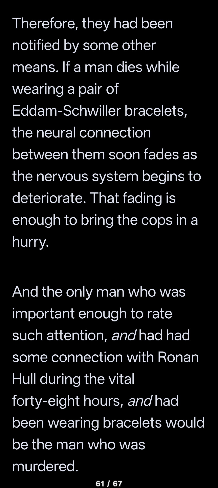
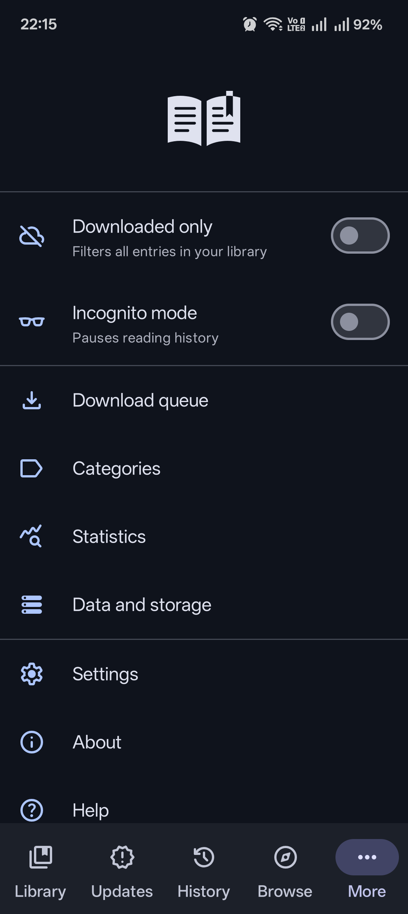

<div align="center">


# Novelon

### A novel reader for Android

Browse sources, build a library and read novels as clean, adjustable text: online or offline.

[](./LICENSE)
[](#building)
[](https://developer.android.com/compose)
[](https://github.com/mihonapp/mihon)
[](#roadmap)


&nbsp;&nbsp;


</div>

## About

Novelon takes [Mihon](https://github.com/mihonapp/mihon), a mature manga reader, and turns it into a reader for
text novels. The library, sources, downloads and backups stay; the image viewers give way to a reader built for
text. Sources return each chapter as HTML, and Novelon lays it out at the font size and line spacing you choose.

> [!NOTE]
> Novelon is not affiliated with or endorsed by the Mihon project.

## Features

| | |
| --- | --- |
| **Text reader** | Scrolls through a chapter paragraph by paragraph and carries on into the next chapter. Tap to page down. |
| **Your layout** | Font size, line spacing, and the reader's light, dark and grey themes. |
| **Never lose your place** | Progress is saved per chapter. Reopen one and a *Last seen* line marks where you stopped. |
| **Offline reading** | Download chapters and read them without a connection. |
| **Public-domain classics** | A built-in [Project Gutenberg](https://www.gutenberg.org) source. |
| **Extensions** | More sources as separate, installable extensions, each trusted once before it runs. |
| **Library** | Categories, scheduled updates for new chapters, reading history and statistics. |
| **Backups** | Back up your library locally or to the cloud service you prefer. |

## Getting started

1. Build and install the app (see [Building](#building)).
2. Open **Browse** and pick a source, such as **Project Gutenberg**.
3. Open a novel and tap **Add to library**.
4. Tap a chapter to start reading. Tap the middle of the screen for the menu, and open the reader settings to
   change the font size and line spacing.
5. To read offline, download chapters from the novel's chapter list.

## Extensions

Novelon itself ships only the Project Gutenberg source. Every other source is an **extension**: a small APK
built from its own repository, the way Mihon handles sources. Extensions are kept out of this repository on
purpose.

To get them, open **Settings → Browse → Extension repos** and add

```
https://raw.githubusercontent.com/Dextonek/novelon-extensions/main/index.min.json
```

then install and update extensions from **Browse → Extensions**. Extensions from that repository are trusted
through its signing key; one installed by hand asks you to trust it the first time Novelon finds it.

To write a source, implement the usual Mihon `HttpSource` methods for listing and details, and
`getChapterText(chapter)`, which returns the chapter body as HTML.

## Roadmap

| | Milestone | State |
| --- | --- | --- |
| ✅ | Rebrand from Mihon | Done |
| ✅ | Novel source API (`getChapterText`) | Done |
| ✅ | Built-in Project Gutenberg source | Done; catalogue lookups are unreliable at times |
| ✅ | Text reader | Done |
| ✅ | Offline downloads | Done |
| ✅ | [Extension repository](https://github.com/Dextonek/novelon-extensions) for in-app installs | Done |
| ⏳ | Local EPUB files | Planned |
| ⏳ | Text-to-speech, page mode, a signed release | Planned |

## Building

| Requirement | Version |
| --- | --- |
| JDK | 24 or 25 |
| Android SDK | platform 37.2, build-tools 37.0.0 |
| Android device | 8.0 or newer |

```sh
./gradlew assembleDebug
```

The APKs land in `app/build/outputs/apk/debug/`. The debug build installs as `io.github.dextonek.novelon.dev`
with a brown icon, so it can sit next to a release build.

## Project layout

Novelon keeps Mihon's modules and internal names (`Manga`, `SChapter`, `eu.kanade.tachiyomi`); only what users
see was renamed. The novel-specific code lives here:

| Path | What |
| --- | --- |
| `source-api/.../source/Source.kt` | `getChapterText`, the call that turns a chapter into HTML |
| `app/.../ui/reader/novel/` | The text reader: splitting chapters into blocks and showing them |
| `app/.../mihon/source/gutenberg/` | The built-in Project Gutenberg source |
| `app/.../extension/util/ExtensionLoader.kt` | Finding and trusting installed extensions |
| `docs/` | [Handover](./docs/HANDOVER.md) and [status log](./docs/STATUS.md) |

## Contributing

Work happens on the **`novel/main`** branch; `main` tracks Mihon. Before you start:

* read [AGENTS.md](./AGENTS.md) for the rules on code, comments and commits;
* read [docs/HANDOVER.md](./docs/HANDOVER.md) and [docs/STATUS.md](./docs/STATUS.md) for where things stand;
* run `./gradlew check` before every commit.

## Credits

Novelon is built on [Mihon](https://github.com/mihonapp/mihon) and, before it, Tachiyomi. Thanks to everyone who
contributed to them. Public-domain books come from [Project Gutenberg](https://www.gutenberg.org).

## Disclaimer

The developers of this application have no affiliation with the content providers available, and the
application hosts no content.

## License

Novelon is licensed under the Apache License 2.0, like Mihon.

<pre>
Copyright © 2015 Javier Tomás
Copyright © 2024 Mihon Open Source Project

Licensed under the Apache License, Version 2.0 (the "License");
you may not use this file except in compliance with the License.
You may obtain a copy of the License at

http://www.apache.org/licenses/LICENSE-2.0

Unless required by applicable law or agreed to in writing, software
distributed under the License is distributed on an "AS IS" BASIS,
WITHOUT WARRANTIES OR CONDITIONS OF ANY KIND, either express or implied.
See the License for the specific language governing permissions and
limitations under the License.
</pre>
